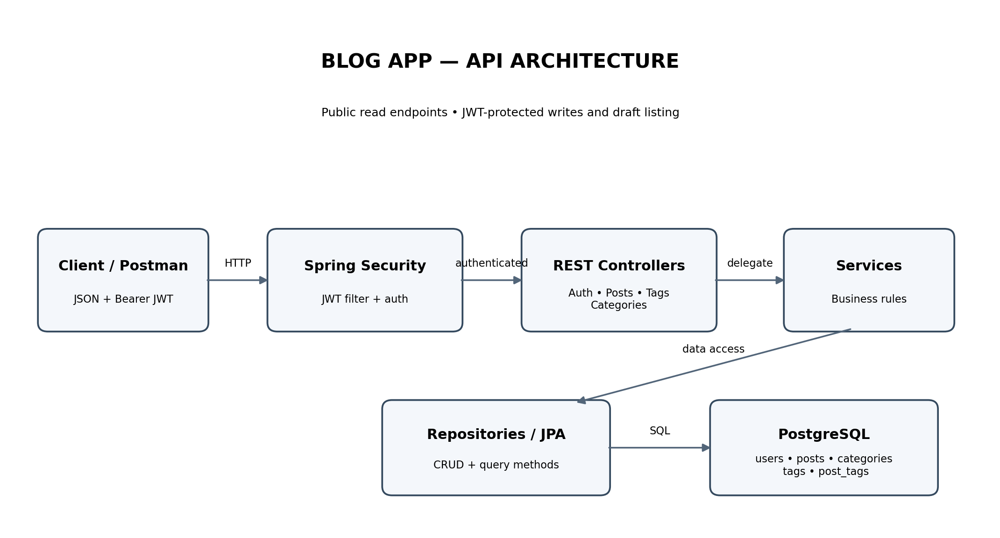
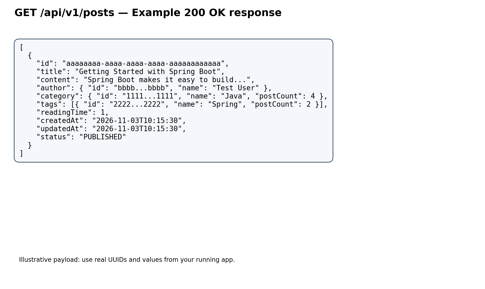

# Blog App — API Documentation

> Documentation generated by inspecting the uploaded `Blog-App-main` source code.
>
> **Base URL:** `http://localhost:8080`  
> **API prefix:** `/api/v1`  
> **Content type:** `application/json`  
> **Authentication:** JWT Bearer token for protected routes.

## Contents

- [Run the application](#run-the-application)
- [Authentication](#authentication)
- [Endpoint index](#endpoint-index)
- [Posts API](#posts-api)
- [Categories API](#categories-api)
- [Tags API](#tags-api)
- [Error responses](#error-responses)
- [Data models](#data-models)
- [Postman setup](#postman-setup)
- [Source-code notes](#source-code-notes)

## Run the application

Ensure PostgreSQL is running and the database/configuration values in `application.yml` or `application.properties` match your local setup. Then start the app from the project directory:

```bash
./mvnw spring-boot:run
```

If using an installed Maven:

```bash
mvn spring-boot:run
```

Set the base URL in Postman:

```text
http://localhost:8080
```

## Authentication

The login endpoint is public. Other write operations and the drafts endpoint require a valid JWT. Public GET routes include posts, categories, and tags.

### Login

**POST** `/api/v1/auth/login`

Headers:

```http
Content-Type: application/json
```

Request:

```json
{
  "email": "user@test.com",
  "password": "password"
}
```

The project seeds a test user on startup if it does not already exist:

- Email: `user@test.com`
- Password: `password`

Successful response — **200 OK**:

```json
{
  "token": "<JWT_TOKEN>",
  "expiresIn": 86400
}
```

`expiresIn` is expressed in seconds (24 hours). For protected calls, use:

```http
Authorization: Bearer <JWT_TOKEN>
Content-Type: application/json
```

The token subject is the authenticated user's email.

## Endpoint index

| Method | Endpoint | Auth | Description |
|---|---|---|---|
| POST | `/api/v1/auth/login` | Public | Log in and obtain JWT |
| GET | `/api/v1/posts` | Public | List published posts; optional filters |
| GET | `/api/v1/posts/{id}` | Public | Fetch a post by ID |
| GET | `/api/v1/posts/drafts` | JWT | List drafts for current user |
| POST | `/api/v1/posts` | JWT | Create a post |
| PUT | `/api/v1/posts/{id}` | JWT | Update a post |
| DELETE | `/api/v1/posts/{id}` | JWT | Delete a post |
| GET | `/api/v1/categories` | Public | List categories |
| POST | `/api/v1/categories` | JWT | Create a category |
| DELETE | `/api/v1/categories/{id}` | JWT | Delete a category* |
| GET | `/api/v1/tags` | Public | List tags |
| POST | `/api/v1/tags` | JWT | Create tags (batch) |
| DELETE | `/api/v1/tags/{id}` | JWT | Delete a tag |

\* The category delete mapping currently has a route typo in source; see [Source-code notes](#source-code-notes).

## Posts API

### 1. List published posts

**GET** `/api/v1/posts`

No body. Query parameters are optional:

| Parameter | Type | Description |
|---|---|---|
| `categoryId` | UUID | Filter by category |
| `tagId` | UUID | Filter by tag |

Examples:

```http
GET /api/v1/posts
GET /api/v1/posts?categoryId=11111111-1111-1111-1111-111111111111
GET /api/v1/posts?tagId=22222222-2222-2222-2222-222222222222
GET /api/v1/posts?categoryId=11111111-1111-1111-1111-111111111111&tagId=22222222-2222-2222-2222-222222222222
```

Successful response — **200 OK** (array; may be empty):

```json
[
  {
    "id": "aaaaaaaa-aaaa-aaaa-aaaa-aaaaaaaaaaaa",
    "title": "Getting Started with Spring Boot",
    "content": "Spring Boot makes it easy to build stand-alone applications...",
    "author": {
      "id": "bbbbbbbb-bbbb-bbbb-bbbb-bbbbbbbbbbbb",
      "name": "Test User"
    },
    "category": {
      "id": "11111111-1111-1111-1111-111111111111",
      "name": "Java",
      "postCount": 4
    },
    "tags": [
      {
        "id": "22222222-2222-2222-2222-222222222222",
        "name": "Spring",
        "postCount": 2
      }
    ],
    "readingTime": 1,
    "createdAt": "2026-11-03T10:15:30",
    "updatedAt": "2026-11-03T10:15:30",
    "status": "PUBLISHED"
  }
]
```

This endpoint returns published posts only. The UUIDs and dates above are illustrative.

### 2. Get a post

**GET** `/api/v1/posts/{id}`

Example:

```http
GET /api/v1/posts/aaaaaaaa-aaaa-aaaa-aaaa-aaaaaaaaaaaa
```

Successful response — **200 OK**: one `PostDto`, with the same shape as an item in the list response above.

### 3. List my drafts

**GET** `/api/v1/posts/drafts`

Requires JWT. No body.

```http
Authorization: Bearer <JWT_TOKEN>
```

Successful response — **200 OK**:

```json
[
  {
    "id": "aaaaaaaa-aaaa-aaaa-aaaa-aaaaaaaaaaaa",
    "title": "Draft: Spring Security",
    "content": "Notes about authentication and authorization...",
    "author": {
      "id": "bbbbbbbb-bbbb-bbbb-bbbb-bbbbbbbbbbbb",
      "name": "Test User"
    },
    "category": {
      "id": "11111111-1111-1111-1111-111111111111",
      "name": "Java",
      "postCount": 0
    },
    "tags": [],
    "readingTime": 1,
    "createdAt": "2026-11-03T10:15:30",
    "updatedAt": "2026-11-03T10:15:30",
    "status": "DRAFT"
  }
]
```

The list is scoped to the authenticated user and draft status.

### 4. Create a post

**POST** `/api/v1/posts`

Requires JWT.

Request:

```json
{
  "title": "Getting Started with Spring Boot",
  "content": "Spring Boot makes it easy to build stand-alone applications. This post explains the basics.",
  "categoryId": "11111111-1111-1111-1111-111111111111",
  "tagIds": [
    "22222222-2222-2222-2222-222222222222"
  ],
  "status": "PUBLISHED"
}
```

Fields:

| Field | Required | Rules |
|---|---|---|
| `title` | Yes | Nonblank, 3–200 characters |
| `content` | Yes | Nonblank, 10–50,000 characters |
| `categoryId` | Yes | Existing category UUID |
| `tagIds` | No | Set of existing tag UUIDs; maximum 10; defaults to empty |
| `status` | Yes | `DRAFT` or `PUBLISHED` |

Successful response — **201 Created**: a `PostDto` (single object), as shown in the list response. The server sets the author from the JWT, computes `readingTime`, and manages timestamps.

### 5. Update a post

**PUT** `/api/v1/posts/{id}`

Requires JWT. The request body includes an `id` field as defined by the DTO; the path ID is used to find the post.

Request:

```json
{
  "id": "aaaaaaaa-aaaa-aaaa-aaaa-aaaaaaaaaaaa",
  "title": "Spring Boot — Updated Guide",
  "content": "Updated content with at least ten characters.",
  "categoryId": "11111111-1111-1111-1111-111111111111",
  "tagIds": [
    "22222222-2222-2222-2222-222222222222"
  ],
  "status": "PUBLISHED"
}
```

Rules are the same as create, with `id` required. Successful response — **200 OK**: updated `PostDto`.

### 6. Delete a post

**DELETE** `/api/v1/posts/{id}`

Requires JWT.

```http
DELETE /api/v1/posts/aaaaaaaa-aaaa-aaaa-aaaa-aaaaaaaaaaaa
Authorization: Bearer <JWT_TOKEN>
```

Successful response — **204 No Content** (empty body).

> **Implementation observation:** the controller/service code does not visibly check that the authenticated user owns the post before update/delete. Treat this as a security issue to address before production.

## Categories API

### 1. List categories

**GET** `/api/v1/categories`

No body; public.

Successful response — **200 OK**:

```json
[
  {
    "id": "11111111-1111-1111-1111-111111111111",
    "name": "Java",
    "postCount": 4
  },
  {
    "id": "33333333-3333-3333-3333-333333333333",
    "name": "Databases",
    "postCount": 2
  }
]
```

`postCount` counts published posts.

### 2. Create category

**POST** `/api/v1/categories`

Requires JWT.

Request:

```json
{
  "name": "Backend Development"
}
```

Validation: nonblank; 2–50 characters; letters, numbers, spaces, and hyphens only.

Successful response — **201 Created**:

```json
{
  "id": "44444444-4444-4444-4444-444444444444",
  "name": "Backend Development",
  "postCount": 0
}
```

A duplicate name (case-insensitive) is rejected by the service.

### 3. Delete category

Intended endpoint: **DELETE** `/api/v1/categories/{id}`

Requires JWT. Successful response is **204 No Content** (empty body), if the category exists and has no posts.

If it has posts, service logic raises a conflict-like business error. The current controller mapping is malformed (`@DeleteMapping(path = "/{id")`) and must be corrected before this endpoint will match the intended URL.

## Tags API

### 1. List tags

**GET** `/api/v1/tags`

No body; public.

Successful response — **200 OK**:

```json
[
  {
    "id": "22222222-2222-2222-2222-222222222222",
    "name": "Spring",
    "postCount": 2
  },
  {
    "id": "55555555-5555-5555-5555-555555555555",
    "name": "Java",
    "postCount": 5
  }
]
```

`postCount` counts published posts.

### 2. Create tags (batch)

**POST** `/api/v1/tags`

Requires JWT.

Request:

```json
{
  "names": [
    "Spring",
    "Java",
    "REST API"
  ]
}
```

Validation declared in `CreateTagsRequest`: at least one name, at most 10 names; each name 2–30 characters and letters, numbers, spaces, or hyphens. Existing names are reused; newly created and matching existing tags are returned together.

Successful response — **201 Created**:

```json
[
  {
    "id": "22222222-2222-2222-2222-222222222222",
    "name": "Spring",
    "postCount": 0
  },
  {
    "id": "55555555-5555-5555-5555-555555555555",
    "name": "Java",
    "postCount": 0
  },
  {
    "id": "66666666-6666-6666-6666-666666666666",
    "name": "REST API",
    "postCount": 0
  }
]
```

### 3. Delete tag

**DELETE** `/api/v1/tags/{id}`

Requires JWT.

Successful response — **204 No Content** if the tag exists and is not associated with posts. If it is attached to posts, the service throws an `IllegalStateException` and the global handler returns **409 Conflict**.

## Error responses

The global exception handler in the project defines these shapes/statuses. Exact validation-error behavior may also be affected by Spring's default handling because there is no explicit `MethodArgumentNotValidException` handler in the inspected advice.

### 400 Bad Request

Example for a service-level `IllegalArgumentException`:

```json
{
  "status": 400,
  "message": "Category with name Java already exists",
  "errors": null
}
```

### 401 Unauthorized

Example for invalid login credentials:

```json
{
  "status": 401,
  "message": "Incorrect username or password",
  "errors": null
}
```

### 409 Conflict

Example when trying to delete a tag linked to posts:

```json
{
  "status": 409,
  "message": "Cannot delete tag with posts",
  "errors": null
}
```

### 500 Internal Server Error

Unexpected exception:

```json
{
  "status": 500,
  "message": "An unexpected error occurred",
  "errors": null
}
```

`errors` is an optional list of field errors in the response DTO. The source's generic exception handler returns the generic 500 message; not-found exceptions are not explicitly mapped to 404 in the inspected advice.

## Data models

### PostDto

```json
{
  "id": "UUID",
  "title": "string",
  "content": "string",
  "author": {
    "id": "UUID",
    "name": "string"
  },
  "category": {
    "id": "UUID",
    "name": "string",
    "postCount": 0
  },
  "tags": [
    {
      "id": "UUID",
      "name": "string",
      "postCount": 0
    }
  ],
  "readingTime": 1,
  "createdAt": "yyyy-MM-ddTHH:mm:ss",
  "updatedAt": "yyyy-MM-ddTHH:mm:ss",
  "status": "DRAFT | PUBLISHED"
}
```

### API error object

```json
{
  "status": 400,
  "message": "Description of the error",
  "errors": [
    {
      "field": "title",
      "message": "Title is required"
    }
  ]
}
```

## Postman setup

1. Create a collection named **Blog App**.
2. Add collection variable `baseUrl` = `http://localhost:8080`.
3. Send login request to `{{baseUrl}}/api/v1/auth/login`.
4. Copy the returned token and set collection variable `token`.
5. For protected requests, add header:

```http
Authorization: Bearer {{token}}
Content-Type: application/json
```

6. For public GET calls, the token is not required.
7. Use actual UUIDs returned by category/tag create/list endpoints in post requests.

## Source-code notes

These findings are included to help avoid confusing documentation examples with current behavior:

1. **Category delete mapping typo:** `CategoryController` currently declares `@DeleteMapping(path = "/{id")`; change to `@DeleteMapping(path = "/{id}")`.
2. **No registration endpoint was found** in the controllers. The project creates a development test account from `SecurityConfig`.
3. **Post update/delete ownership is not enforced** in the visible service/controller code. A valid login does not necessarily mean the caller owns the requested post.
4. **Authentication filter behavior:** invalid Bearer tokens are logged and the filter continues. Protected endpoints should still require authentication; public GET routes may continue unauthenticated.
5. **Error mapping:** `EntityNotFoundException` is not explicitly mapped to 404 in `ErrorController`; it currently falls under the generic exception handler in this advice.
6. **Input validation:** create/update post and create category have `@Valid`; tag request has constraints but its controller does not use `@Valid`, so those annotations may not be enforced there.
7. Response UUIDs, dates, sample counts, and content in this document are illustrative. Use the actual values returned by your running application.

## API visual




