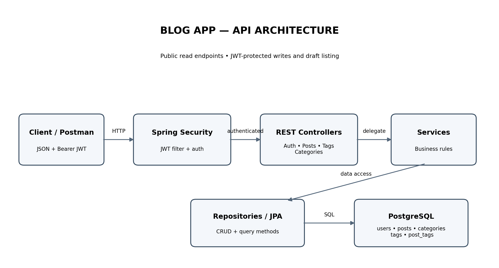
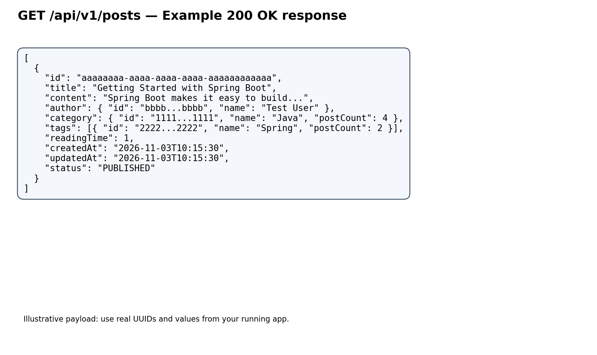

# 📝 Blog Application — Spring Boot

A RESTful Blog Application built using **Java, Spring Boot, Spring Security, JWT Authentication, and PostgreSQL**.

This project provides secure APIs for managing blog posts, categories, and tags. It follows a layered architecture with controllers, services, repositories, and database entities.

## 📚 Table of Contents

- [Features](#-features)
- [Tech Stack](#-tech-stack)
- [Architecture](#-architecture)
- [API Documentation](#-api-documentation)
- [API Endpoints](#-api-endpoints)
- [Project Structure](#-project-structure)
- [Getting Started](#-getting-started)
- [Authentication](#-authentication)
- [API Response Example](#-api-response-example)
- [Future Improvements](#-future-improvements)
- [Author](#-author)

## ✨ Features

- RESTful API development using Spring Boot
- JWT-based authentication and authorization
- Create, read, update, and delete blog posts
- Manage blog categories
- Manage tags with batch creation
- Filter published posts by category and tag
- Manage user-specific draft posts
- PostgreSQL database integration
- Spring Data JPA and Hibernate
- Request validation
- Centralized exception handling
- Maven-based project management

## 🛠️ Tech Stack

| Technology | Purpose |
|---|---|
| Java | Programming Language |
| Spring Boot | Backend Framework |
| Spring Security | Authentication and Authorization |
| JWT | Token-Based Authentication |
| Spring Data JPA | Database Access |
| Hibernate | ORM |
| PostgreSQL | Relational Database |
| Maven | Build Tool |
| Lombok | Reduce Boilerplate Code |
| Git & GitHub | Version Control |

## 🏗️ Architecture

The application follows a layered architecture.



### Architecture Layers

- **Controller Layer:** Handles incoming HTTP requests and API responses.
- **Service Layer:** Contains business logic and application operations.
- **Repository Layer:** Communicates with the database using Spring Data JPA.
- **Entity Layer:** Represents database tables.
- **Security Layer:** Handles JWT authentication and authorization.
- **Database Layer:** Stores users, posts, categories, and tags.

## 📖 API Documentation

Complete API documentation is available here:

### 👉 [View Complete API Documentation](./API_DOCUMENTATION.md)

The documentation includes:

- All API endpoints
- HTTP methods
- Request headers
- JSON request body examples
- JSON response examples
- JWT authentication
- Error responses
- Postman testing instructions

## 🔗 API Endpoints

Base URL:

```text
http://localhost:8080
```

API Prefix:

```text
/api/v1
```

### Authentication

| Method | Endpoint | Description |
|---|---|---|
| POST | `/api/v1/auth/login` | Authenticate user and generate JWT |

### Posts

| Method | Endpoint | Description |
|---|---|---|
| GET | `/api/v1/posts` | Get published posts |
| GET | `/api/v1/posts/{id}` | Get post by ID |
| GET | `/api/v1/posts/drafts` | Get authenticated user's drafts |
| POST | `/api/v1/posts` | Create a blog post |
| PUT | `/api/v1/posts/{id}` | Update a blog post |
| DELETE | `/api/v1/posts/{id}` | Delete a blog post |

### Categories

| Method | Endpoint | Description |
|---|---|---|
| GET | `/api/v1/categories` | Get all categories |
| POST | `/api/v1/categories` | Create a category |
| DELETE | `/api/v1/categories/{id}` | Delete a category |

### Tags

| Method | Endpoint | Description |
|---|---|---|
| GET | `/api/v1/tags` | Get all tags |
| POST | `/api/v1/tags` | Create multiple tags |
| DELETE | `/api/v1/tags/{id}` | Delete a tag |

For detailed request and response payloads, refer to [API_DOCUMENTATION.md](./API_DOCUMENTATION.md).

## 📂 Project Structure

```text
Blog-App/
│
├── src/
│   ├── main/
│   │   ├── java/
│   │   │   └── com/dev/blog/
│   │   │       ├── config/
│   │   │       ├── controllers/
│   │   │       ├── domain/
│   │   │       │   ├── entities/
│   │   │       │   └── repositories/
│   │   │       ├── dto/
│   │   │       ├── exceptions/
│   │   │       ├── security/
│   │   │       └── services/
│   │   │
│   │   └── resources/
│   │       └── application.yml
│   │
│   └── test/
│
├── API_DOCUMENTATION.md
├── blog_api_architecture.png
├── blog_api_response_example.png
├── README.md
├── pom.xml
└── mvnw
```

## 🚀 Getting Started

Follow these steps to run the project locally.

### Prerequisites

Make sure you have installed:

- Java JDK
- Maven
- PostgreSQL
- Git
- IntelliJ IDEA or VS Code

### 1. Clone the Repository

```bash
git clone https://github.com/MallikarjunPadanad/Blog-App.git
```

Navigate to the project directory:

```bash
cd Blog-App
```

### 2. Configure PostgreSQL

Create a database:

```sql
CREATE DATABASE blog;
```

Create a database user if required:

```sql
CREATE USER appuser WITH PASSWORD 'your_password';

GRANT ALL PRIVILEGES ON DATABASE blog TO appuser;
```

Configure your database credentials in `src/main/resources/application.yml`.

Example:

```yaml
spring:
  datasource:
    url: jdbc:postgresql://localhost:5432/blog
    username: appuser
    password: ${DB_PASSWORD}

  jpa:
    hibernate:
      ddl-auto: update
    show-sql: true
```

> Never commit real database passwords, JWT secrets, or other credentials to GitHub.

### 3. Configure Environment Variables

Set your database password and JWT secret before running the application.

Example:

```bash
export DB_PASSWORD="your_database_password"
export JWT_SECRET="your_secure_secret_key"
```

Ensure your application configuration reads the corresponding environment variables.

### 4. Run the Application

Using Maven Wrapper:

```bash
./mvnw spring-boot:run
```

Or using Maven:

```bash
mvn spring-boot:run
```

The application will start at:

```text
http://localhost:8080
```

## 🔐 Authentication

The application uses JWT-based authentication.

### Login API

```http
POST /api/v1/auth/login
Content-Type: application/json
```

Request:

```json
{
  "email": "user@test.com",
  "password": "password"
}
```

Successful response:

```json
{
  "token": "<JWT_TOKEN>",
  "expiresIn": 86400
}
```

Use the generated JWT token for protected endpoints.

```http
Authorization: Bearer <JWT_TOKEN>
```

Refer to the [Authentication Documentation](./API_DOCUMENTATION.md#authentication) for details.

## 📤 API Response Example

Example response for:

```http
GET /api/v1/posts
```



The API returns blog posts with author, category, tags, reading time, timestamps, and publication status.

## 🧪 Testing

You can test the REST APIs using:

- Postman
- IntelliJ HTTP Client
- cURL

For detailed request payloads and response examples, see:

👉 [Complete API Documentation](./API_DOCUMENTATION.md)

## 🔮 Future Improvements

- Swagger / OpenAPI integration
- Pagination and sorting
- Refresh token implementation
- Role-based access control
- User registration API
- Post ownership validation
- Unit and integration testing
- Docker and Docker Compose
- CI/CD pipeline
- Cloud deployment

## 👨‍💻 Author

**Mallikarjun Padanad**

- GitHub: [MallikarjunPadanad](https://github.com/MallikarjunPadanad)
- Repository: [Blog-App](https://github.com/MallikarjunPadanad/Blog-App)

---

⭐ If you find this project useful, consider giving it a star!

